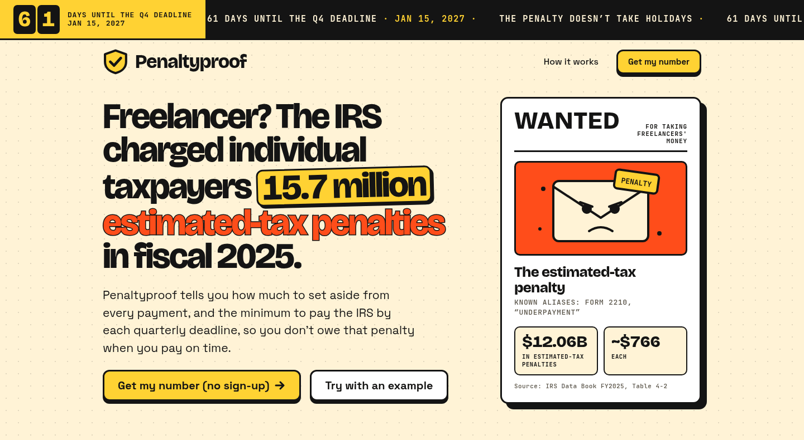
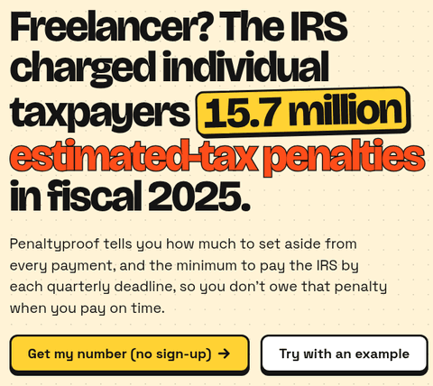
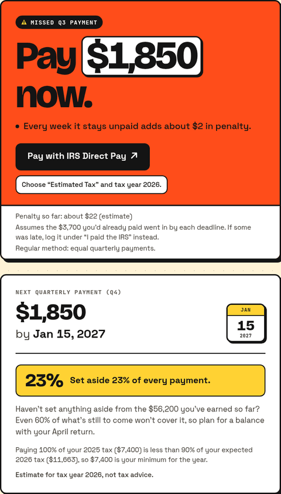
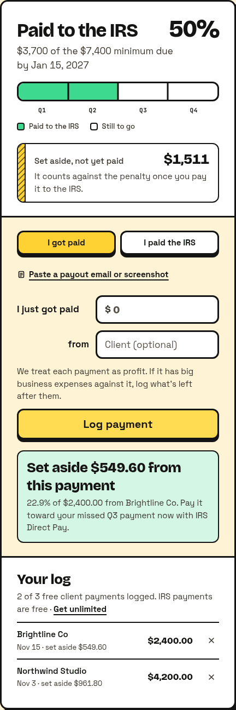
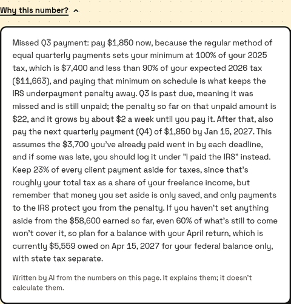
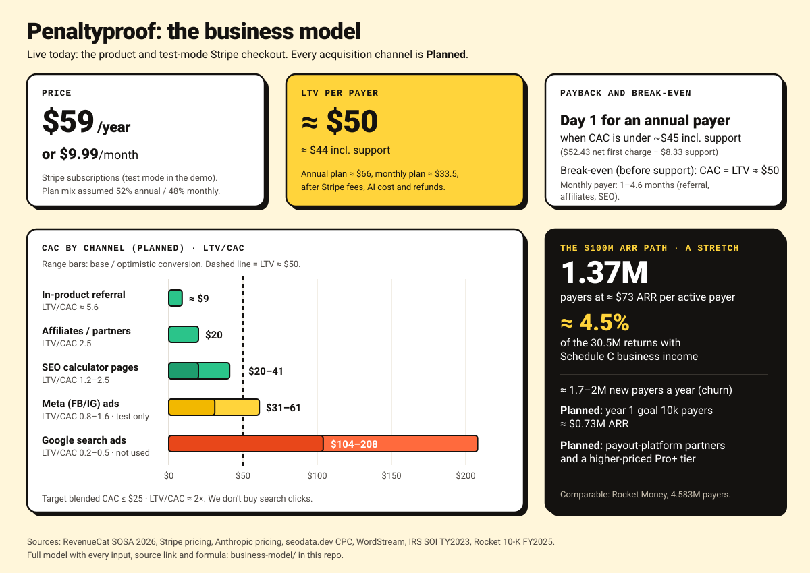

# Penaltyproof

**Know what to set aside from every client payment, and the minimum to pay the IRS by each quarterly deadline, so a US freelancer who pays on time doesn't owe an estimated-tax penalty.**

**Live: [zimran.incode.kz](https://zimran.incode.kz)**: no sign-up. Click "Try with an example" for a full plan in one click. Pro checkout is Stripe test mode: card `4242 4242 4242 4242`, any future date, any CVC.

[](https://zimran.incode.kz)

## The problem and the user

- **The IRS charged individual taxpayers 15.7 million estimated-tax penalties in fiscal 2025**: $12.06B, about $766 each. 1 in 3 penalties on individual returns is for underpaying estimated tax, and it applies even if you get a refund. ([IRS Data Book FY2025, Table 4-2](https://www.irs.gov/pub/irs-soi/25db-4-02-cp.xlsx))
- **Freelancers have no withholding.** No tax is taken out. Pay too little during the year and the IRS fines you, then sends one big bill in April.
- **Who:** a first- or second-year 1099 worker, paid unevenly by several clients. 30.5M tax returns report Schedule C business income ([IRS SOI, TY2023](https://www.irs.gov/pub/irs-soi/23in14ar.xls)); 58% of self-employed adults say their income varies month to month ([Federal Reserve, 2025](https://www.federalreserve.gov/publications/files/2025-report-economic-well-being-us-households-202605.pdf)).

## How it works

| | |
|---|---|
| **1. Open the site.** No account. Answer six questions, or press **Try with an example**. |  |
| **2. Six questions:** filing status, state, freelance profit so far and expected, W-2, last year's tax, what you've paid. |  |
| **3. Your plan:** the minimum to pay the IRS now and by the next deadline ("Pay $1,850 now"), and the share of every payment to set aside (23%). Deadlines go to your calendar as an `.ics` file. |  |
| **4. Log every payment.** Each client payment shows the set-aside in dollars and cents; each IRS payment fills the meter against the legal minimum due so far. |  |
| **5. Why this number?** Claude explains the plan in plain English. Every number in the answer is checked against the engine before you see it. |  |

**Pro** ($59 a year or $9.99 a month) adds unlimited logging, reading payouts from a screenshot, an annualized-method comparison for uneven income (the plan itself always uses the regular method), "Ask why" chat and a CSV for an accountant.

### The code calculates; the AI explains

The tax engine in `lib/tax/` (a verbatim copy of `engine/src`) computes everything: federal income tax, self-employment tax, state tax, the safe-harbor minimum (Form 1040-ES), the instalment schedule, the penalty estimate (Form 2210), the annualized method (Schedule AI), the set-aside rate and the calendar file. The UI only selects and formats its results (`lib/product/`). Every number the AI writes is checked against the engine's figures before you see it. If one doesn't match, the answer is regenerated; if it still fails, a fixed explanation is shown.

AI features (Claude, server-side):

- **Why this number?** (`POST /api/explain`): a short plain-English explanation of your plan, sent once it has passed the number check below.
- **Ask about your numbers** (`POST /api/ask`, Pro): questions answered from your own plan and log.
- **Paste a payout email or screenshot** (`POST /api/read-payment`; screenshots need Pro): fills in amount, client and date for you to check before logging.

**The number guard.** The model sees only display strings of the engine's results, plus filing status, state and the log (payer names cleaned). The prompts forbid arithmetic. For Why this number? and Ask, the server holds back the whole answer and checks every number in it (dollar amounts, percentages, plain numbers) against the facts the model was given; formatting variants and rounded percentages match, and Ask also allows numbers the person typed. Amounts written with a magnitude ("15k", "$2.5 million") or in words ("twelve hundred") are always treated as unknown. If any number is unknown, the server asks the model once more with the exact figures it may use. If that answer fails too, it sends a fixed explanation built from the engine's own sentences (Ask: "I can only answer with the numbers in your plan." plus the relevant plan line). Only checked text reaches the browser (`lib/product/ai-numbers.ts`), with an `x-guard` response header saying which path it took (`clean`, `retried` or `template`). A retry is part of the same request and its rate-limit count. Payout reading returns checked fields, not text. Requests are rate-limited per guest and IP.

## Business model

[](business-model/)

- **$59 a year or $9.99 a month. LTV ≈ $50 per payer** (≈ $44 incl. support), after Stripe fees, AI cost and refunds.
- **We don't buy search clicks** (CAC $104–208, LTV/CAC 0.2–0.5). Planned channels: in-product referral (≈ $9), affiliates ($20), SEO calculator pages ($20–41). An annual payer pays back on day 1 when CAC is under ~$45 incl. support.
- **$100M ARR = 1.37M payers** at ≈ $73 ARR per active payer, **≈ 4.5% of the 30.5M returns with Schedule C business income**, needing ≈ 1.7–2M new payers a year. A stretch: it needs distribution partners (Planned).

Full model and sources → [business-model/](business-model/) ([model.csv](business-model/model.csv): every input with its source link, every derived figure with its formula).

<!-- Talking to real people: photo + quotes pending -->

## Tech and quality

- Next.js 16 (App Router, Cache Components, standalone output), TypeScript, Tailwind CSS v4, shadcn/ui
- Anthropic API (`@anthropic-ai/sdk`), Stripe Checkout (`stripe`), Supabase (`@supabase/supabase-js`)
- pnpm, Vitest

**Tests:** `pnpm test` runs 345 tests in 21 files, all passing: **71 engine** tests (`lib/tax/__tests__`, including four personas checked by hand against the IRS worksheet, below) and **274 product** tests: input building, the meter, pay-now split, quiz validation, storage, server copy, the guest cookie, Pro helpers, CSV, AI facts, rate limits and the AI number guard (unknown numbers held back, one retry, then a fixed template).

### Verified against the IRS worksheet

We ran four freelancer personas (tax year 2026, as of Nov 14, 2026, Texas so federal only) through the engine and through the 2026 Form 1040-ES worksheet by hand, and through a popular free calculator for comparison. The engine matches the hand-done worksheet to the cent for all four.

"Required" is the required annual payment (Form 1040-ES line 12c). "Due by Jan 15" is what has to be paid by 2027-01-15 so that the Q4 instalment is not short, given that nothing has been paid yet.

| Persona | Engine (`estimate()`) | 1040-ES worksheet by hand | A popular free calculator | Diff / flag |
|---|---|---|---|---|
| **A** single, $60k 1099, 2025 tax $8k | Total tax **$12,037.20**. Required **$8,000** (100% of prior year). Due by Jan 15: **$8,000** (Q1–Q3 past due). With $2k paid on each of Apr 15, Jun 15 and Sep 15: **$2,000** | $12,037.20; $8,000; $2,000/qtr | Total $12,037. **"$2,708 each quarter"** = $10,833/yr (90% of current year) | Engine = hand to the cent. The calculator asks for **$2,833 too much** because it has no prior-year input. It also cannot take payments already made. |
| **B** MFJ, W-2 $85k with $7k withheld, spouse $25k 1099, 2025 tax $9k | $11,602.83. Required **$9,000**. Withholding counts as $1,750/qtr. Due by Jan 15: **$2,000** (Q1–Q3 short $500 each) | $11,602.83; $9,000; L14a $2,000, $500/qtr | Run 1 (W-2 entered as the spouse's): **"No", $0, "refund $1,341"**, because the calculator invented $12,943 of withholding. Run 2 (fields swapped): **"$860 each quarter"** = $3,442/yr | Engine = hand. Calculator run 2 asks for **$1,442 too much** (90% current minus withholding). Run 1 is wrong. |
| **C** single rideshare, $45k 1099 ($30k Sep–Dec), 2025 tax $4k | $8,579.50. Required **$4,000**. Regular: $1,000/qtr, due by Jan 15 **$4,000**. `annualized()`: **$801.90 / $801.90 / $801.90 / $1,594.31**, total $4,000 | $8,579.50; $4,000. Schedule AI by hand: 801.90 ×3, 1,594.31 | Total $8,579. **"$1,930 each quarter"** = $7,721.55/yr | Engine = hand, including Schedule AI. The calculator asks for **$3,722 too much**. It has no income-timing input. |
| **D** single, $220k 1099, 2025 tax $40k, 2025 AGI $180k | $57,783.35. Required **$44,000** (110%). Due by Jan 15: **$44,000** | $57,783.35; $44,000 | Total $57,784. **"$13,001 each quarter"** = $52,004/yr | Engine = hand. The calculator asks for **$8,004 too much**. |

The worksheet was worked by our team independently of the engine code, not by a CPA.

### Guest mode

No accounts. Answers and the payment log live in `localStorage` (`lib/product/store.ts`), with a copy on the server keyed by an anonymous guest cookie (`GET/PUT /api/plan-data`), restored into an empty browser. Pro status is stored per guest on the server (`GET /api/pro`).

### Run locally

```bash
pnpm i
cp .env.example .env.local   # fill in values; test-mode Stripe keys only
pnpm dev                     # http://localhost:3000
pnpm test
```

The app builds and runs without Supabase: `/api/health` reports supabase as "not configured" and every guest is on the Free plan.

| Name | Purpose |
| --- | --- |
| `ANTHROPIC_API_KEY` | Server-side key for Claude calls. |
| `STRIPE_SECRET_KEY` | Stripe secret key; must be a test-mode key. |
| `NEXT_PUBLIC_STRIPE_PUBLISHABLE_KEY` | Stripe publishable key (test mode); build-time. |
| `STRIPE_WEBHOOK_SECRET` | Signing secret for `/api/stripe/webhook`; webhook returns 503 when unset. |
| `NEXT_PUBLIC_SUPABASE_URL` | Supabase project URL; build-time. |
| `SUPABASE_SERVICE_ROLE_KEY` | Supabase service role key, used only on the server. |
| `APP_URL` | Public base URL for Stripe redirects; falls back to the request origin (honours `x-forwarded-host`/`-proto`). |
| `APP_PORT` | Host port for docker compose (default 3100, bound to localhost only). |

**Supabase:** run `supabase/schema.sql` in the Supabase SQL editor. It creates `guests` and `health_checks` with RLS enabled and no policies, so only the server (service role) can access them.

**Stripe (test mode only):** `lib/stripe.ts` refuses non-test keys. The Pro plan is a subscription created inline with `price_data`, so no Stripe products or prices need to exist. Pro is recorded on `/checkout/success` and, if configured, by the `checkout.session.completed` webhook (both idempotent).

### Deploy

```bash
cp .env.example .env   # fill in values
docker compose up -d --build
curl http://localhost:3100/api/health
```

The image runs the standalone `server.js` on port 3000; compose publishes it on localhost only, for a reverse proxy in front that terminates TLS. `NEXT_PUBLIC_*` values are passed as build args from `.env`.

<details>
<summary>Routes and server helpers</summary>

- `/` landing, `/start` quiz, `/plan` plan and log, `/how-we-check` verification page, `/app` guest status, `/pricing` paywall, `/checkout/success` confirmation
- `POST /api/guest`, `POST /api/checkout`, `POST /api/stripe/webhook`, `GET /api/health`, `GET/PUT /api/plan-data`, `GET /api/pro`, `POST /api/explain`, `POST /api/ask`, `POST /api/read-payment`
- `lib/ai.ts`: `getAnthropic()`, `MODEL`
- `lib/guest.ts`: `getGuestId()`, `getOrCreateGuestId()`
- `lib/supabase.ts`: `isSupabaseConfigured()`, `getSupabaseAdmin()`, `ensureGuest()`, `isPro()`, `setPro()`
- `lib/stripe.ts`: `getStripe()`, `PLANS`, `createCheckoutSession()`, `getOrigin()`, `formatPlanPrice()`

</details>

## Known limitations

- **Tax year 2026 only.** Dates, forms and the log are tied to tax year 2026 (dates from Jan 1, 2026 to Apr 15, 2027); 2027 income is not supported yet.
- **Short prior tax year.** The quiz doesn't ask whether your 2025 return covered a full 12 months; the plan assumes it did. The prior-year safe harbor doesn't apply after a short tax year, so in that case the minimum shown can be too low.
- **Married filing jointly with a W-2.** W-2 wages and withholding are entered as one household figure, not per person. The plan treats those wages as the spouse's, so if the freelancer has their own W-2 job, self-employment tax and the set-aside rate can come out too high.
- **Subscriptions are test-mode only.** Pro is turned on when checkout completes; renewals, cancellations, refunds and expiry are not handled yet.
- **Saved per browser.** The plan and Pro status are tied to an anonymous cookie in one browser. There is no account, so another browser or a lost cookie can't recover them.
- **Cloud backup is capped at 64 KB per plan.** Bigger plans keep working in the browser, but the server copy stops updating.
- **The free-tier limit (3 "I got paid" entries) is enforced in the browser**, not by the server.
- **Calendar file after Jan 15, 2027.** The .ics after Jan 15, 2027 can double-count the catch-up (in the pay-now event and again in April); fix planned.
- **Re-saving in a later month.** Saving the same answers in a later month re-dates the year-to-date income used for the annualized comparison.
- **Save races.** An older save arriving late can overwrite a newer one, and a failed "Start over" can bring back the cloud copy.

## Team

Team Esep: Baltabay Zhanybek, Bekzat Rashiduly. Built for Zimran Business Cup 2026.
